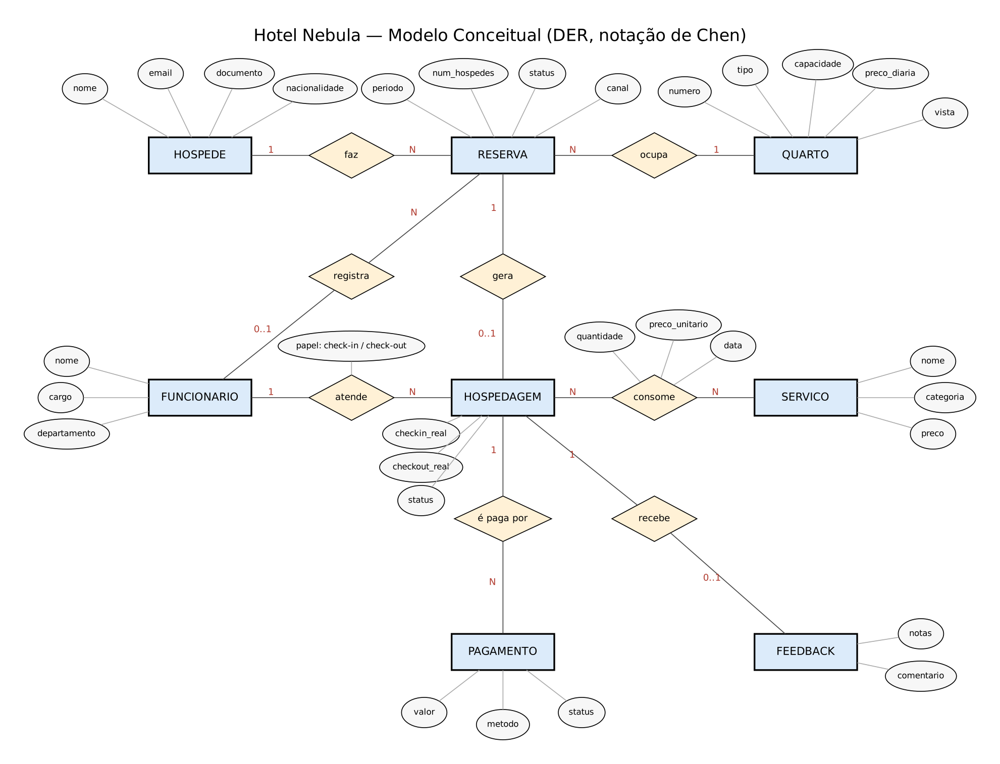
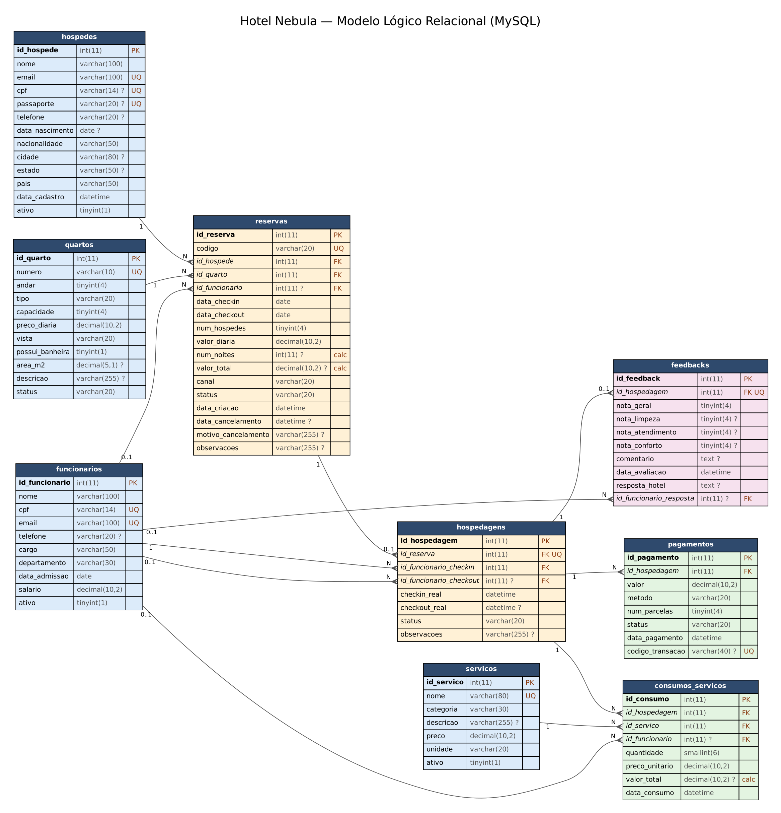
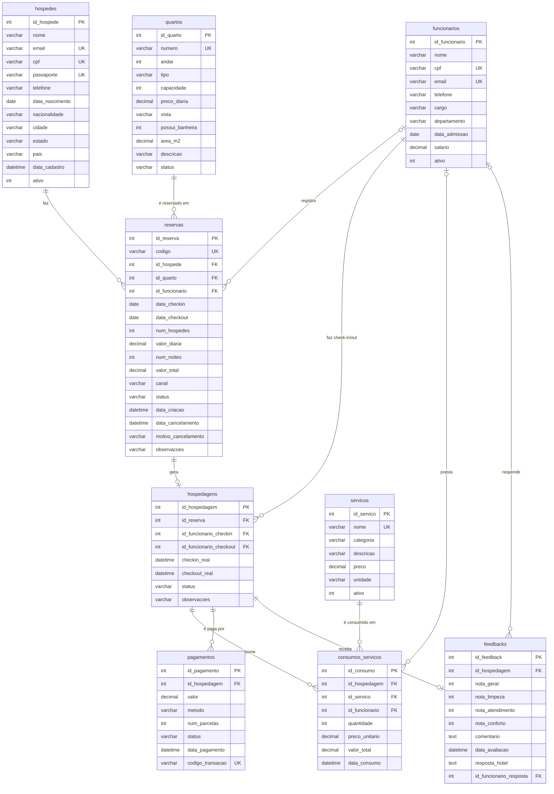

# Parte 1: Origem do Sistema

Compreensão do problema, modelo conceitual e modelo lógico do banco de dados do **Hotel Nebula**.

## 1. Compreensão do problema

Hoje os dados do hotel estão espalhados entre sistemas diferentes, planilhas e papel. O objetivo é reunir tudo num único banco relacional, que depois servirá de base para uma API de gestão hoteleira.

O ciclo de vida que o banco precisa representar é este:

```text
Hóspede faz uma RESERVA de um QUARTO para um período
   └─► no dia da chegada, a reserva vira uma HOSPEDAGEM (check-in feito por um FUNCIONÁRIO)
          ├─► durante a estadia, o hóspede CONSOME SERVIÇOS extras (prestados por funcionários)
          ├─► no check-out, a conta (diárias + serviços) é quitada com um ou mais PAGAMENTOS
          └─► depois da saída, o hóspede pode deixar um FEEDBACK (avaliação)
```

Uma distinção importante: **reserva ≠ hospedagem**. A reserva é a intenção, com datas previstas, e pode ser cancelada ou virar *no-show*. A hospedagem é a estadia que aconteceu de fato, com horários reais. Como nem toda reserva vira hospedagem, as duas ficam em tabelas separadas.

## 2. Entidades

| Entidade | O que representa | Atributos principais |
|---|---|---|
| **Hóspede** | Cliente que reserva e se hospeda | nome, e-mail, CPF ou passaporte, telefone, nascimento, nacionalidade, cidade/país |
| **Quarto** | Unidade que pode ser reservada | número, andar, tipo, capacidade, preço da diária, vista, banheira, área, status |
| **Funcionário** | Profissional do hotel | nome, CPF, e-mail, cargo, departamento, admissão, salário |
| **Reserva** | Pedido de um quarto para um período | código, datas previstas, nº de hóspedes, diária combinada, canal, status, cancelamento |
| **Hospedagem** | Estadia efetiva (check-in realizado) | entrada e saída reais, funcionário do check-in e do check-out, status |
| **Serviço** | Item do catálogo de serviços extras | nome, categoria, preço, unidade de cobrança |
| **Consumo de serviço** | Serviço usado numa hospedagem (entidade associativa) | quantidade, preço cobrado, data, funcionário que prestou |
| **Pagamento** | Valor pago referente a uma hospedagem | valor, método, parcelas, status, data, código da transação |
| **Feedback** | Avaliação do hóspede sobre a estadia | notas (geral, limpeza, atendimento, conforto), comentário, resposta do hotel |

## 3. Relacionamentos

| Relacionamento | Cardinalidade | Explicação |
|---|---|---|
| Hóspede **faz** Reserva | 1 : N | Um hóspede pode ter várias reservas; cada reserva pertence a um hóspede |
| Reserva **ocupa** Quarto | N : 1 | Cada reserva é de um quarto; um quarto recebe muitas reservas ao longo do tempo |
| Funcionário **registra** Reserva | 0..1 : N | Reservas por telefone ou balcão têm o funcionário que registrou; as de site, app e agência não têm |
| Reserva **gera** Hospedagem | 1 : 0..1 | Uma reserva gera no máximo uma hospedagem; canceladas e *no-show* não geram nenhuma |
| Funcionário **atende** Hospedagem | 1 : N | Toda hospedagem tem um funcionário no check-in e, ao encerrar, um no check-out |
| Hospedagem **consome** Serviço | N : N | Resolvido pela tabela associativa `consumos_servicos`, que tem atributos próprios |
| Hospedagem **é paga por** Pagamento | 1 : N | Uma conta pode ser paga em partes (ex.: cartão + pix) ou ter uma tentativa recusada |
| Hospedagem **recebe** Feedback | 1 : 0..1 | Uma avaliação por estadia, opcional |
| Funcionário **responde** Feedback | 0..1 : N | A resposta do hotel registra quem respondeu |

> **Por que o feedback se liga à hospedagem, e não direto ao hóspede e ao quarto?** Porque só faz sentido avaliar uma estadia que aconteceu. O hóspede e o quarto são encontrados pelo caminho `feedback → hospedagem → reserva`. Guardar `id_hospede` e `id_quarto` de novo no feedback duplicaria dados e poderia gerar inconsistência (3ª forma normal).

## 4. Regras de negócio

| # | Regra | Como é garantida no banco |
|---|---|---|
| RN01 | Todo hóspede tem e-mail único e pelo menos um documento (CPF ou passaporte) | `UNIQUE` + `CHECK chk_hospedes_documento` |
| RN02 | Um quarto não pode ter duas reservas ativas com períodos que se sobrepõem | trigger `trg_reservas_validar_insert/update` |
| RN03 | O número de hóspedes não pode passar da capacidade do quarto | trigger de reservas |
| RN04 | Quartos em manutenção ou inativos não aceitam novas reservas | trigger de reservas |
| RN05 | A data de check-out é posterior à de check-in | `CHECK chk_reservas_datas` |
| RN06 | A reserva guarda a diária combinada (o preço do quarto pode mudar depois) | coluna `reservas.valor_diaria` |
| RN07 | Número de noites e valor total da reserva são calculados, nunca digitados | colunas geradas `num_noites` e `valor_total` |
| RN08 | Reserva cancelada precisa ter data de cancelamento | `CHECK chk_reservas_cancelamento` |
| RN09 | Só há check-in (hospedagem) para reserva confirmada; cada reserva tem no máximo uma hospedagem | trigger `trg_hospedagens_validar_insert` + `UNIQUE(id_reserva)` |
| RN10 | Hospedagem encerrada precisa de horário de saída e do funcionário do check-out; ao encerrar, a reserva vira "concluída" | `CHECK chk_hospedagens_encerrada` + trigger `trg_hospedagens_concluir_reserva` |
| RN11 | O consumo guarda o preço cobrado no dia, com quantidade maior que zero | `consumos_servicos.preco_unitario` + `CHECK` |
| RN12 | Pagamento tem valor positivo e método válido; só cartão de crédito pode ser parcelado (até 12x) | `CHECK`s em `pagamentos` |
| RN13 | Só se avalia hospedagem encerrada, uma vez, com notas de 1 a 5 | trigger `trg_feedbacks_validar_insert` + `UNIQUE` + `CHECK`s |
| RN14 | A resposta do hotel a um feedback identifica o funcionário que respondeu | `CHECK chk_feedbacks_resposta` |
| RN15 | Se o quarto está ocupado numa data é calculado pelas reservas, não guardado no quarto | `quartos.status` indica só ativo/manutenção/inativo |

## 5. Modelo conceitual (DER)

Notação de Chen: retângulos são entidades, losangos são relacionamentos e elipses são atributos.



## 6. Modelo lógico relacional

O ponto de partida foi o modelo incompleto do repositório da turma (`sample-databases/Tabelas/8_HOTEL_NEBULA/modelo_logico.md`). Para completá-lo:

- acrescentei as colunas que faltavam em todas as tabelas (marcadas como "adicionar mais");
- criei as tabelas `servicos` e `feedbacks`;
- criei a tabela associativa `consumos_servicos`, que resolve o N:N entre hospedagens e serviços;
- incluí as FKs de funcionários em `reservas`, `hospedagens`, `consumos_servicos` e `feedbacks`;
- revisei tipos e restrições (`NOT NULL`, `DEFAULT`, `CHECK`, `UNIQUE`).



Legenda: **PK** chave primária · **FK** chave estrangeira · **UQ** valor único · **calc** coluna calculada · **?** aceita nulo.

O mesmo modelo em Mermaid (o GitHub desenha automaticamente):



### Dicionário de dados

#### `hospedes`

| Coluna | Tipo | Restrições | Descrição |
|---|---|---|---|
| id_hospede | INT | PK, AUTO_INCREMENT | Identificador do hóspede |
| nome | VARCHAR(100) | NOT NULL | Nome completo |
| email | VARCHAR(100) | UNIQUE, NOT NULL | E-mail (único) |
| cpf | VARCHAR(14) | UNIQUE | CPF (brasileiros) |
| passaporte | VARCHAR(20) | UNIQUE | Passaporte (estrangeiros) |
| telefone | VARCHAR(20) |  | Telefone com DDI/DDD |
| data_nascimento | DATE |  | Data de nascimento |
| nacionalidade | VARCHAR(50) | NOT NULL, DEFAULT Brasileira | Nacionalidade |
| cidade | VARCHAR(80) |  | Cidade de origem |
| estado | VARCHAR(50) |  | Estado/província |
| pais | VARCHAR(50) | NOT NULL, DEFAULT Brasil | País |
| data_cadastro | DATETIME | NOT NULL, DEFAULT CURRENT_TIMESTAMP | Quando foi cadastrado |
| ativo | BOOLEAN | NOT NULL, DEFAULT 1 | Registro ativo? |

#### `quartos`

| Coluna | Tipo | Restrições | Descrição |
|---|---|---|---|
| id_quarto | INT | PK, AUTO_INCREMENT | Identificador do quarto |
| numero | VARCHAR(10) | UNIQUE, NOT NULL | Número do quarto (ex.: 301) |
| andar | TINYINT | NOT NULL | Andar |
| tipo | VARCHAR(20) | NOT NULL | standard, luxo, suite ou presidencial |
| capacidade | TINYINT | NOT NULL | Máximo de pessoas |
| preco_diaria | DECIMAL(10,2) | NOT NULL | Preço atual da diária |
| vista | VARCHAR(20) | NOT NULL, DEFAULT cidade | mar, cidade, jardim ou montanha |
| possui_banheira | BOOLEAN | NOT NULL, DEFAULT 0 | Tem banheira? |
| area_m2 | DECIMAL(5,1) |  | Área em m² |
| descricao | VARCHAR(255) |  | Descrição |
| status | VARCHAR(20) | NOT NULL, DEFAULT ativo | ativo, manutencao ou inativo |

#### `funcionarios`

| Coluna | Tipo | Restrições | Descrição |
|---|---|---|---|
| id_funcionario | INT | PK, AUTO_INCREMENT | Identificador do funcionário |
| nome | VARCHAR(100) | NOT NULL | Nome completo |
| cpf | VARCHAR(14) | UNIQUE, NOT NULL | CPF (brasileiros) |
| email | VARCHAR(100) | UNIQUE, NOT NULL | E-mail (único) |
| telefone | VARCHAR(20) |  | Telefone com DDI/DDD |
| cargo | VARCHAR(50) | NOT NULL | Cargo |
| departamento | VARCHAR(30) | NOT NULL | Departamento |
| data_admissao | DATE | NOT NULL | Data de admissão |
| salario | DECIMAL(10,2) | NOT NULL | Salário |
| ativo | BOOLEAN | NOT NULL, DEFAULT 1 | Registro ativo? |

#### `reservas`

| Coluna | Tipo | Restrições | Descrição |
|---|---|---|---|
| id_reserva | INT | PK, AUTO_INCREMENT | Reserva |
| codigo | VARCHAR(20) | UNIQUE, NOT NULL | Código para o cliente (HN-2026-0001) |
| id_hospede | INT | FK → hospedes, NOT NULL | Identificador do hóspede |
| id_quarto | INT | FK → quartos, NOT NULL | Identificador do quarto |
| id_funcionario | INT | FK → funcionarios | Quem registrou (telefone/balcão); NULL = site/app/agência |
| data_checkin | DATE | NOT NULL | Data prevista de entrada |
| data_checkout | DATE | NOT NULL | Data prevista de saída |
| num_hospedes | TINYINT | NOT NULL, DEFAULT 1 | Quantidade de pessoas |
| valor_diaria | DECIMAL(10,2) | NOT NULL | Diária combinada na reserva |
| num_noites | INT | GERADA | Calculado: checkout − checkin |
| valor_total | DECIMAL(10,2) | GERADA | Calculado: noites × diária |
| canal | VARCHAR(20) | NOT NULL, DEFAULT site | site, app, telefone, balcao ou agencia |
| status | VARCHAR(20) | NOT NULL, DEFAULT pendente | pendente, confirmada, cancelada, concluida ou no_show |
| data_criacao | DATETIME | NOT NULL, DEFAULT CURRENT_TIMESTAMP | Quando a reserva foi feita |
| data_cancelamento | DATETIME |  | Quando foi cancelada |
| motivo_cancelamento | VARCHAR(255) |  | Motivo informado |
| observacoes | VARCHAR(255) |  | Observações |

#### `hospedagens`

| Coluna | Tipo | Restrições | Descrição |
|---|---|---|---|
| id_hospedagem | INT | PK, AUTO_INCREMENT | Hospedagem |
| id_reserva | INT | FK → reservas, UNIQUE, NOT NULL | Reserva |
| id_funcionario_checkin | INT | FK → funcionarios, NOT NULL | Quem fez o check-in |
| id_funcionario_checkout | INT | FK → funcionarios | Quem fez o check-out |
| checkin_real | DATETIME | NOT NULL | Entrada efetiva |
| checkout_real | DATETIME |  | Saída efetiva |
| status | VARCHAR(20) | NOT NULL, DEFAULT em_andamento | em_andamento ou encerrada |
| observacoes | VARCHAR(255) |  | Observações |

#### `servicos`

| Coluna | Tipo | Restrições | Descrição |
|---|---|---|---|
| id_servico | INT | PK, AUTO_INCREMENT | Serviço |
| nome | VARCHAR(80) | UNIQUE, NOT NULL | Nome completo |
| categoria | VARCHAR(30) | NOT NULL | Categoria do serviço |
| descricao | VARCHAR(255) |  | Descrição |
| preco | DECIMAL(10,2) | NOT NULL | Preço atual |
| unidade | VARCHAR(20) | NOT NULL, DEFAULT unidade | Unidade de cobrança |
| ativo | BOOLEAN | NOT NULL, DEFAULT 1 | Registro ativo? |

#### `consumos_servicos`

| Coluna | Tipo | Restrições | Descrição |
|---|---|---|---|
| id_consumo | INT | PK, AUTO_INCREMENT | Identificador do consumo |
| id_hospedagem | INT | FK → hospedagens, NOT NULL | Hospedagem |
| id_servico | INT | FK → servicos, NOT NULL | Serviço |
| id_funcionario | INT | FK → funcionarios | Quem prestou o serviço |
| quantidade | SMALLINT | NOT NULL, DEFAULT 1 | Quantidade consumida |
| preco_unitario | DECIMAL(10,2) | NOT NULL | Preço cobrado no dia |
| valor_total | DECIMAL(10,2) | GERADA | Calculado: quantidade × preço |
| data_consumo | DATETIME | NOT NULL | Quando foi consumido |

#### `pagamentos`

| Coluna | Tipo | Restrições | Descrição |
|---|---|---|---|
| id_pagamento | INT | PK, AUTO_INCREMENT | Identificador do pagamento |
| id_hospedagem | INT | FK → hospedagens, NOT NULL | Hospedagem |
| valor | DECIMAL(10,2) | NOT NULL | Valor pago |
| metodo | VARCHAR(20) | NOT NULL | pix, cartao_credito, cartao_debito, dinheiro ou transferencia |
| num_parcelas | TINYINT | NOT NULL, DEFAULT 1 | Parcelas (1–12) |
| status | VARCHAR(20) | NOT NULL, DEFAULT aprovado | pendente, aprovado, recusado ou estornado |
| data_pagamento | DATETIME | NOT NULL | Data/hora do pagamento |
| codigo_transacao | VARCHAR(40) | UNIQUE | Código da operadora/banco |

#### `feedbacks`

| Coluna | Tipo | Restrições | Descrição |
|---|---|---|---|
| id_feedback | INT | PK, AUTO_INCREMENT | Identificador da avaliação |
| id_hospedagem | INT | FK → hospedagens, UNIQUE, NOT NULL | Hospedagem |
| nota_geral | TINYINT | NOT NULL | Nota de 1 a 5 |
| nota_limpeza | TINYINT |  | Nota de 1 a 5 |
| nota_atendimento | TINYINT |  | Nota de 1 a 5 |
| nota_conforto | TINYINT |  | Nota de 1 a 5 |
| comentario | TEXT |  | Texto do hóspede |
| data_avaliacao | DATETIME | NOT NULL, DEFAULT CURRENT_TIMESTAMP | Quando avaliou |
| resposta_hotel | TEXT |  | Resposta pública do hotel |
| id_funcionario_resposta | INT | FK → funcionarios | Quem respondeu |

### Decisões de modelagem

- **Chaves substitutas (`id_...` com `AUTO_INCREMENT`).** CPF, número do quarto e código da reserva continuam únicos (`UNIQUE`), mas não são PK. Assim, se um dado de negócio mudar, nenhuma FK quebra.
- **Status como texto validado por `CHECK`.** É mais legível que números e mais fácil de mudar que um `ENUM`.
- **Histórico de preços.** `reservas.valor_diaria` e `consumos_servicos.preco_unitario` guardam o preço do momento. Um reajuste no catálogo não altera estadias antigas.
- **Pagamento ligado à hospedagem.** A conta só existe depois do check-in (diárias + serviços). Por isso reservas canceladas não geram receita.
- **Normalização (3FN).** Não há dado repetido entre tabelas. Os únicos valores derivados (`num_noites` e `valor_total`) são colunas geradas pelo próprio banco, então nunca ficam inconsistentes.
